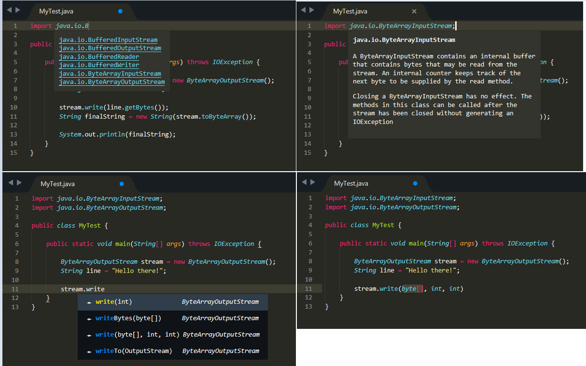

# Intellekt

A sublime text plugin that attempts to provide intellisense for various languages

## Features

### Java

* Method autocomplete suggestions based on imported class
* import autocomplete suggestions and navigation to documentation url
* view class/package description on click to line then hover



### Python

* Method autocompletion

## Recommended settings

Defaults live in `Intellekt.sublime-settings`. Leave them empty unless detection picks the wrong install. Sublime lists the file under Preferences → Package Settings → Intellekt.

```json
{
    "python_executable": "",
    "ruby_executable": "",
    "java_home": "",
    "java_sources": [],
    "node_executable": "",
    "tsc_executable": "",
    "dotnet_root": "",
    "go_executable": "",
    "php_executable": "",
    "rustc_executable": "",
    "cxx_compiler": "",
    "perl_executable": "",
    "matlab_executable": ""
}
```

## Commands

Open the Command Palette with `Cmd+Shift+P` on macOS, or `Ctrl+Shift+P` on Windows and Linux.

* **Intellekt: Rebuild Index** builds the index again, for example after you install a package.
* **Intellekt: Index Status** shows which toolchains were found.

## TODO

* [x] Java
* [x] Python
* [x] Ruby
* [x] C/C++
* [x] CSS
* [x] HTML
* [x] Javascript
* [x] MatLab
* [x] Perl
