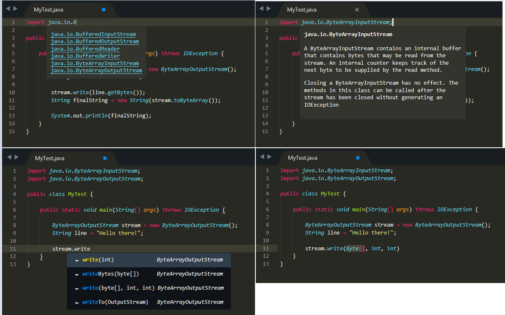

# Intellekt

Autocomplete and hover docs for Sublime Text. It works offline for Python, Java, JavaScript, TypeScript, Go, Rust, C/C++, C#, PHP, Ruby, Perl, MATLAB, CSS and HTML.

## How it works

On startup, Intellekt reads the languages already installed on your computer and builds an index from them. Suggestions come from that index.

If a language server is installed, Intellekt uses it instead, because it gives smarter suggestions. If the server is missing or slow, the index takes over.

## Language servers (optional)

Install a server only for the languages you use.

| Language | Install |
| --- | --- |
| Python | `npm i -g pyright` |
| JavaScript / TypeScript | `npm i -g typescript typescript-language-server` |
| Rust | `rustup component add rust-analyzer` |
| Go | `go install golang.org/x/tools/gopls@latest` |
| C / C++ | Comes with Xcode. On Linux: `apt install clangd` |
| Java | `brew install jdtls` (heavy, only for large projects) |
| PHP | `npm i -g intelephense` |
| Ruby | `gem install ruby-lsp` |
| C# | `dotnet tool install -g csharp-ls` |

After you install one, run **Intellekt: Restart Language Servers**.

## Python virtual environments

Intellekt finds your project's virtual environment (`.venv`, `venv` or `env`) and suggests the packages installed in it. If it picks the wrong one, set `python_executable` in the settings.

## Commands

Open the Command Palette (`Cmd+Shift+P` on macOS, `Ctrl+Shift+P` elsewhere):

* **Intellekt: Rebuild Index**: run this after you install new packages.
* **Intellekt: Index Status**: shows what was found.
* **Intellekt: Restart Language Servers**: run this after you install a server.

## Settings

Preferences → Package Settings → Intellekt. Leave everything empty unless Intellekt picks the wrong program.
