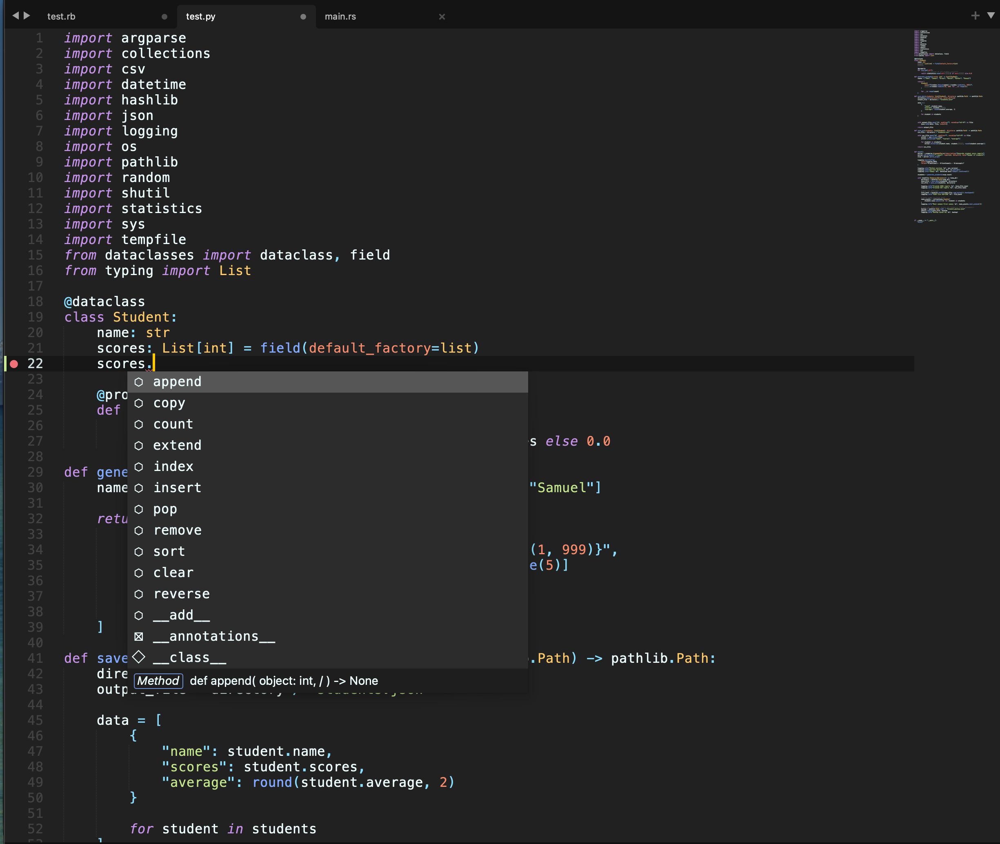
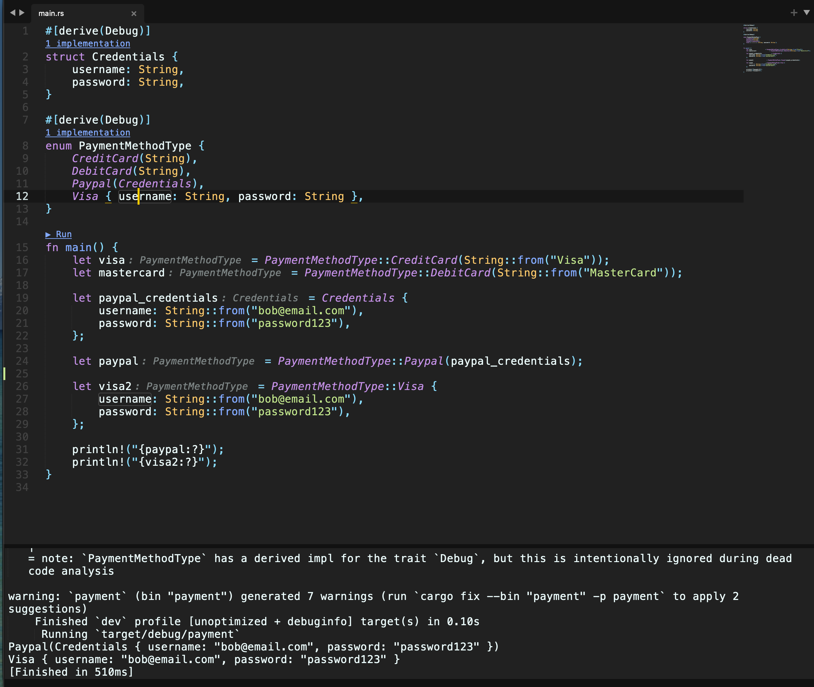
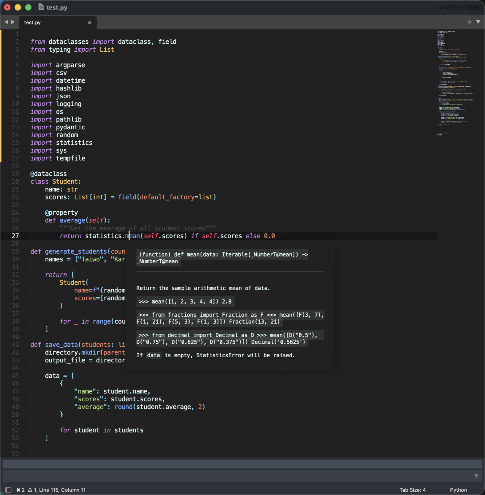
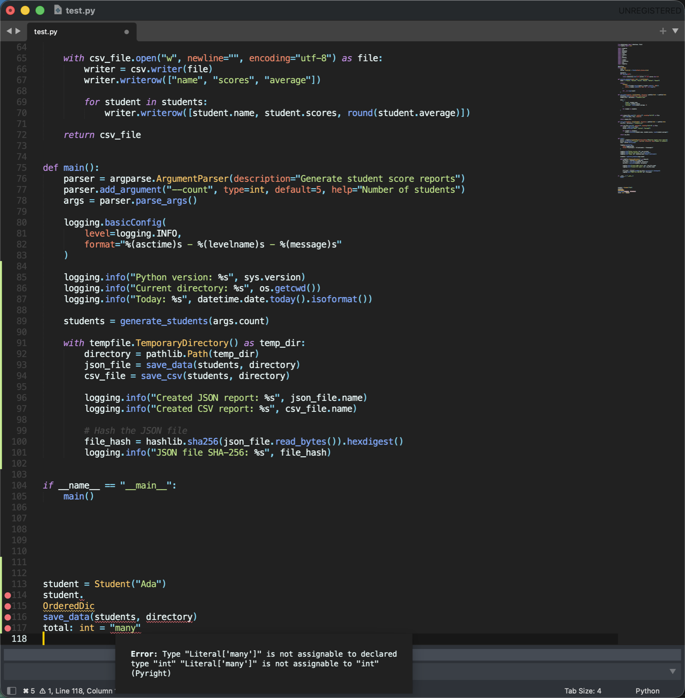
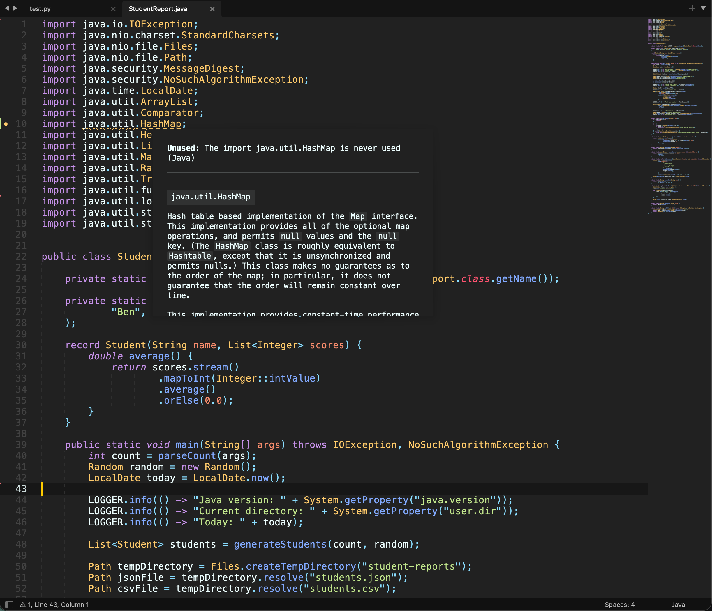
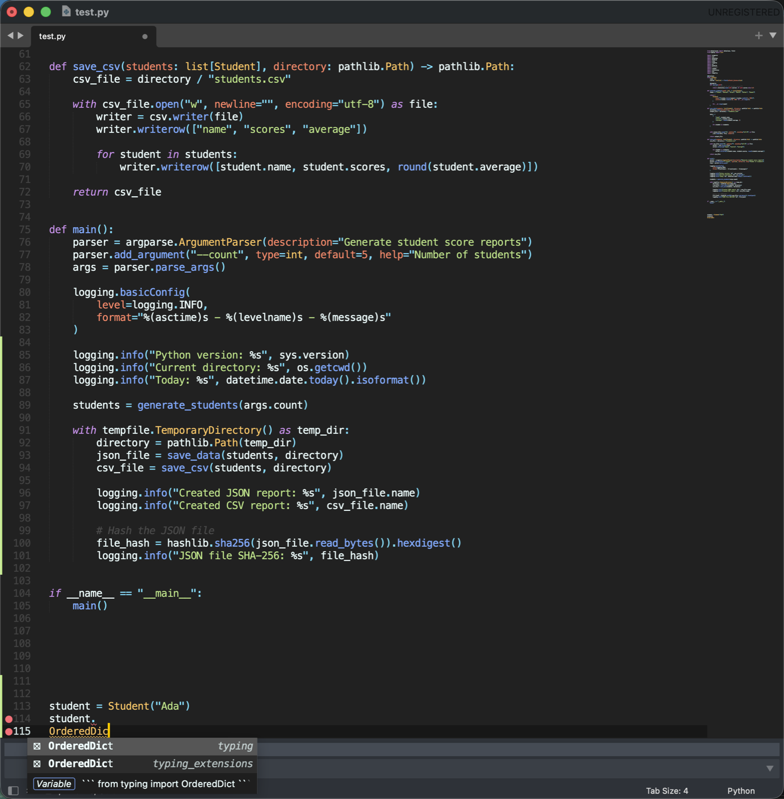
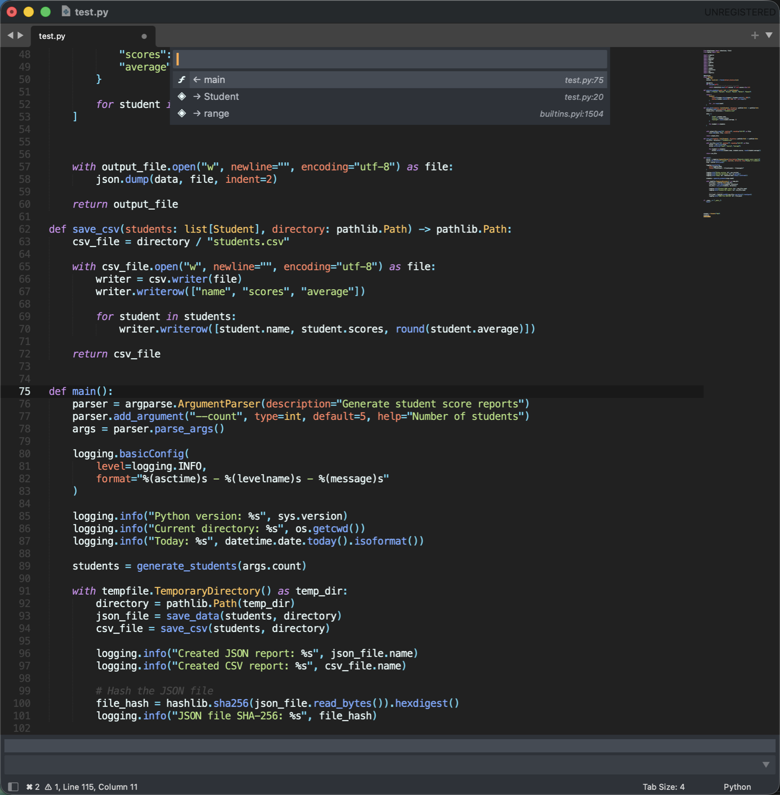
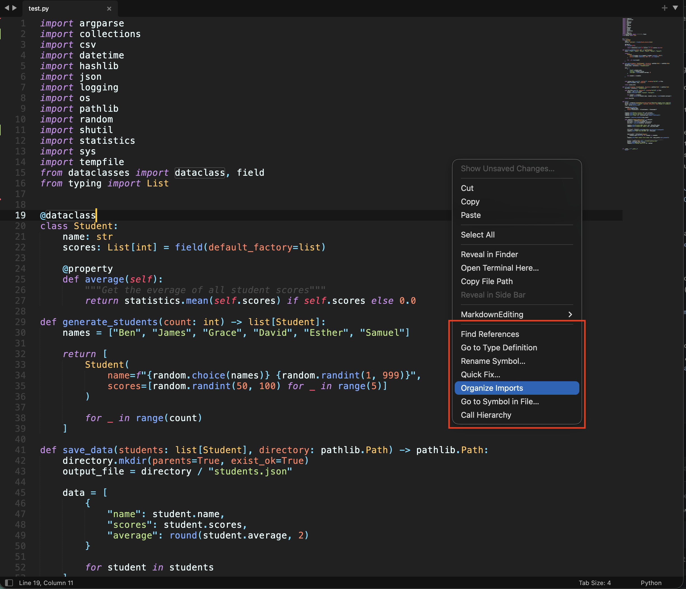

# Intellekt

Turn your sublime text into an intelligent autocomplete engine. It works offline for Python, Java, JavaScript, TypeScript, Go, Rust, C/C++, C#, PHP, Ruby, Perl, MATLAB, CSS and HTML.

## Screenshots

**Completions** with simple icons, the signature and docs



**Rust:** inline types and parameter names, **▶ Run** links and the build output



| | |
| --- | --- |
|  |  |
| **Hover** for documentation | **Errors** underlined as you type, with the message on hover |
|  |  |
| **Unused code** marked, with the reason and docs on hover | **Auto-import:** picking `OrderedDict` adds its import |
|  |  |
| **Call hierarchy:** who calls a function, and what it calls | **Right-click menu** with the code actions |

## How it works

On startup, Intellekt reads the languages already installed on your computer and builds an index from them. Suggestions come from that index.

If a language server is installed, Intellekt uses it instead, because it gives smarter suggestions. If the server is missing or slow, the index takes over. A server also underlines errors and warnings as you type. Hover over a squiggle to read the message.

## Features

**Works out of the box**

* Autocomplete for the standard library and installed packages of 14 languages.
* Hover over a name to read its documentation.
* Python: typing part of a module you have not imported (`pathl`) suggests it (`pathlib`). Picking it adds `import pathlib` below your other imports.
* Finds your project's Python virtual environment and suggests its packages.
* Finds tools installed with Homebrew, nvm, Go, Cargo and similar, even when Sublime is opened from the Dock.

**With a language server installed (Recommended)**

* Smarter suggestions that understand your own code, plus docs in the suggestion list.
* Auto-import: picking a name you have not imported adds the import.
* Errors and warnings underlined as you type, with the count in the status bar. Unused imports, variables and deprecated code get a gray squiggly underline and a gutter circle, and the status bar counts them (`◌ 3 unused`). Hover to read why.
* Parameter help while you type a call.
* The name under the cursor is outlined everywhere it is used.
* Inlay hints: faint inline types and parameter names (C/C++, Rust).
* Code lens: links such as **▶ Run**, **▶ Run Test** and **3 references** above functions (Rust, Ruby). Run opens Sublime's build panel.
* Document links: `#include` paths and similar are underlined. Hover one to open it.
* Go to definition, type definition, declaration and implementation. Find references. Rename across files.
* Format the file or the selection, optionally on save or as you type. Python uses **ruff** or **black** (pyright cannot format).
* Quick fixes and organize imports (when the server has them). Python organize imports uses **ruff** or **isort**.
* Expand or shrink the selection by syntax: word, expression, statement, block.
* Fold the server's code blocks, imports or comments.
* Go to a symbol in the file or project. See who calls a function (call hierarchy) and a type's parents and children (type hierarchy).
* C/C++: switch between source and header.
* Off by default: dimming of C/C++ code left out by `#if`, and **experimental** semantic highlighting (server-based coloring).

**Shortcuts.** Intellekt adds no key bindings by default, except that F12 and Shift+F12 use the language server. These VS Code-style shortcuts are ready to copy: open **Preferences → Package Settings → Intellekt → Key Bindings** (or **Preferences: Intellekt Key Bindings** in the Command Palette) and paste the ones you want from the left file into your own key bindings on the right.

| Action | Mac | Windows | Linux |
| --- | --- | --- | --- |
| Go to definition | F12 | F12 | F12 |
| Go to implementation | Cmd+F12 | Ctrl+F12 | Ctrl+F12 |
| Find references | Shift+F12 | Shift+F12 | Shift+F12 |
| Rename symbol | F2 | F2 | F2 |
| Quick fix | Cmd+. | Ctrl+. | Ctrl+. |
| Format document | Shift+Alt+F | Shift+Alt+F | Ctrl+Shift+I |
| Organize imports | Shift+Alt+O | Shift+Alt+O | Shift+Alt+O |
| Expand / shrink selection | Ctrl+Shift+Cmd+→ / ← | Shift+Alt+→ / ← | Shift+Alt+→ / ← |
| Go to symbol in file | Cmd+Shift+O | Ctrl+Shift+O | Ctrl+Shift+O |
| Go to symbol in project | Cmd+T | Ctrl+T | Ctrl+T |
| Call hierarchy | Shift+Alt+H | Shift+Alt+H | Shift+Alt+H |
| Parameter help | Cmd+Shift+Space | Ctrl+Shift+Space | Ctrl+Shift+Space |

With a binding added, a key in a file without a language server still does what it normally does in Sublime. Everything is also in the Command Palette under **Intellekt:**, including on/off toggles for each feature. The right-click menu shows Intellekt's actions in files with a language server; set `"context_menu": false` to hide them.

Quick fixes and organize imports depend on the server. gopls, clangd and rust-analyzer have them. pyright does not. If no Python tool is found, the status bar says which one to install.

## Language servers (Recommended)

Install a server only for the languages you use. After installing one, run **Intellekt: Restart Language Servers** or restart sublime text.

**Same command on Mac, Windows and Linux**

| Language | Install | Needs |
| --- | --- | --- |
| Python | `npm i -g pyright` | Node.js |
| JavaScript / TypeScript | `npm i -g typescript` (TypeScript 7 includes its server. On older versions also install `typescript-language-server`) | Node.js |
| PHP | `npm i -g intelephense` | Node.js |
| HTML and CSS | `npm i -g vscode-langservers-extracted` | Node.js |
| Rust | `rustup component add rust-analyzer` | [rustup](https://rustup.rs) |
| Go | `go install golang.org/x/tools/gopls@latest` | Go |
| Ruby | `gem install ruby-lsp` | Ruby |
| C# | `dotnet tool install -g csharp-ls` | .NET SDK |
| Python import sorting | `pip install ruff` | Python |

**Different per system**

| Need | Mac | Windows | Linux (Debian/Ubuntu) |
| --- | --- | --- | --- |
| Node.js (for npm) | `brew install node` | `winget install OpenJS.NodeJS.LTS` | `sudo apt install nodejs npm` |
| C / C++ (clangd) | `xcode-select --install` | `winget install LLVM.LLVM` | `sudo apt install clangd` |
| Java (jdtls) | `brew install jdtls` | see below | see below |

**Java on Windows or Linux**

jdtls is heavy, so it is only worth it for real Maven or Gradle projects. It needs Java 21 or newer and Python 3.

1. Download the latest `jdt-language-server-*.tar.gz` from [download.eclipse.org/jdtls/milestones](https://download.eclipse.org/jdtls/milestones/).
2. Unpack it to a folder of its own:
   * Windows: `C:\Tools\jdtls`
   * Linux: `~/.local/share/jdtls` (`mkdir -p ~/.local/share/jdtls && tar -xzf jdt-language-server-*.tar.gz -C ~/.local/share/jdtls`)
3. Put its `bin` folder on your PATH:
   * Windows: add `C:\Tools\jdtls\bin` in *Settings → System → About → Advanced system settings → Environment Variables → Path*.
   * Linux: `ln -s ~/.local/share/jdtls/bin/jdtls ~/.local/bin/jdtls`
4. Check it works: run `jdtls --help` in a new terminal, then restart Sublime Text.

**If a server is not found**

* Open a new terminal and run the server's name, for example `pyright-langserver --version`. If that fails, the install folder is not on your PATH.
* Intellekt also looks in the usual install folders: npm's global folder, `~/go/bin`, `~/.cargo/bin`, `~/.dotnet/tools`, `~/.local/bin` and Homebrew.
* **Intellekt: Index Status** lists which server it found for each language.

## Python virtual environments

Intellekt finds your project's virtual environment (`.venv`, `venv` or `env`) and suggests the packages installed in it. If it picks the wrong one, set `"python": {"executable": "/path/to/python"}` in the settings.

## Commands

Open the Command Palette (`Cmd+Shift+P` on macOS, `Ctrl+Shift+P` elsewhere):

* **Intellekt: Rebuild Index**: run this after you install new packages.
* **Intellekt: Index Status**: shows what was found.
* **Intellekt: Restart Language Servers**: run this after you install a server.

## Settings

Open **Preferences → Package Settings → Intellekt → Settings** (or **Preferences: Intellekt Settings** in the Command Palette). Everything works without changes. Only set a value to override something.

**Feature switches** (apply to every language)

| Setting | Default | What it does |
| --- | --- | --- |
| `lsp_enabled` | `true` | Use installed language servers |
| `context_menu` | `true` | Show Intellekt's actions in the right-click menu |
| `lsp_completion_timeout_ms` | `1500` | How long to wait for a server before showing built-in suggestions |
| `lsp_diagnostics` | `true` | Underline errors and warnings |
| `lsp_signature_help` | `true` | Parameter help while typing a call |
| `lsp_highlight_references` | `true` | Outline other uses of the name under the cursor |
| `lsp_show_hints` | `true` | Mark unused and deprecated code |
| `lsp_inlay_hints` | `true` | Inline types and parameter names |
| `lsp_code_lens` | `true` | Run / references links above functions |
| `lsp_document_links` | `true` | Underline `#include` paths and links |
| `lsp_format_on_save` | `false` | Format when saving |
| `lsp_format_on_type` | `false` | Server fixes after typing `;` or Enter |
| `lsp_semantic_highlighting` | `false` | Experimental server-based coloring. Currently draws colored blocks, so leave off |
| `lsp_inactive_regions` | `false` | Dim C/C++ code left out by `#if` |

**Per language**

Each language has its own block: `python`, `java`, `ruby`, `javascript`, `typescript`, `csharp`, `go`, `php`, `rust`, `cpp`, `css`, `html`, `perl`, `matlab`. A block can hold:

| Key                      | What it sets                                                                                                                                                                 |
| ------------------------ | ---------------------------------------------------------------------------------------------------------------------------------------------------------------------------- |
| `executable`             | The program to use: Python, Ruby, Node.js (`javascript`), `tsc` (`typescript`), Go, PHP, `rustc`, Perl, MATLAB/Octave. For Python it overrides virtual environment detection |
| `java_home`, `sources`   | Java: JDK folder, and extra source zips to index                                                                                                                             |
| `dotnet_root`            | C#: .NET folder                                                                                                                                                              |
| `compiler`               | C/C++: `clang++`or`g++`                                                                                                                                                      |
| `server`                 | `null` to auto-detect, a command such as `["pylsp"]`, or `false` to turn the server off                                                                                      |
| `settings`               | Settings sent to the language server                                                                                                                                         |
| `initialization_options` | Options sent when the server starts                                                                                                                                          |
| any feature switch       | The switch without `lsp_`, for this language only, e.g. `"inlay_hints": false`                                                                                               |

Example:

```json
{
    "lsp_format_on_save": true,
    "python": {
        "executable": "/Users/me/projects/app/.venv/bin/python",
        "settings": {"python": {"analysis": {"typeCheckingMode": "strict"}}}
    },
    "rust": {
        "inlay_hints": false,
        "settings": {"rust-analyzer": {"check": {"command": "clippy"}}}
    },
    "cpp": {"server": false}
}
```
